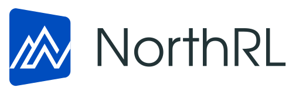

<p align="center">
  <picture>
    <source media="(prefers-color-scheme: dark)" srcset="../imgs/northrl-logo-dark.svg">
    
  </picture>
</p>

<p align="center"><strong>Agentic RL through APIs, without managing GPU infrastructure.</strong></p>

<p align="center">
  <a href="#why-northrl">Why NorthRL</a>&nbsp;·
  <a href="#agentic-rl">Train your agent</a>&nbsp;·
  <a href="#partial-rollout">Partial rollout</a>&nbsp;·
  <a href="#examples">Examples</a>&nbsp;·
  <a href="#getting-started">Get started</a>&nbsp;·
  <a href="index.md">Documentation</a>&nbsp;·
  <a href="../zh/README.md">中文</a>
</p>

---

NorthRL brings reinforcement learning to the agents you build. Train the model behind your agent on your own tasks, with your existing tools, workflows, and evaluation.

**Run NorthRL locally and train through APIs.** [Weaver](https://weaver.nex-agi.cn/) provides model training and sampling, while [NorthGate](https://northgate.xiaobei.top/) connects agent model calls to those services and returns the token data needed for training. You can develop tasks and run experiments without provisioning your own GPU cluster.

<a id="key-features"></a>
<a id="why-northrl"></a>

## Why NorthRL?

- **Training and sampling through APIs.** Run experiments locally, with model training and sampling provided by remote services. Develop tasks, tools, and evaluation without provisioning a GPU cluster.
- **Integrate existing agents.** Keep their tools and execution logic, and connect task execution and scoring hooks. NorthRL automatically records model interactions and updates the model based on task rewards.
- **Asynchronous rollout and training.** With [partial rollout](#partial-rollout), completed rollout groups can enter training while long-running tasks continue across training steps and enter subsequent batches once their groups are complete.

<a id="agentic-rl"></a>

## Train your agent

**1. Prepare tasks and scoring rules**

Define what the agent should accomplish and how to evaluate the result. For a code repair task, for example, provide the issue description and repository, then score the solution based on which tests pass. The resulting score serves as the training reward.

**2. Connect your existing agent**

Use `run_agent` to run your agent and `evaluate` to assess its final answer or task artifacts and return a score. Keep your existing tools and execution logic, and configure the required dependencies in an [E2B](https://e2b.dev/) template. NorthRL coordinates task execution and evaluation in the sandbox.

**3. Connect model services**

[Weaver](https://weaver.nex-agi.cn/) provides model training and sampling, while [NorthGate](https://northgate.xiaobei.top/) connects your agent's model calls to those services. Select a trainable model and have your agent use the OpenAI- or Anthropic-compatible interface supplied by NorthRL. Training trajectories are recorded automatically.

**4. Start training locally**

Configure service credentials and specify the task data, task hooks, E2B template, and model in a training recipe, then launch it locally. NorthRL runs the **task execution → evaluation and scoring → model update** loop. Use task scores and execution records to track training progress.

Refer to the [task example](../../recipe/e2b_minimal/rollout.py) to implement your hooks, then follow the [integration guide](developer-guide/05-rollout-workers/e2b-task-integration.md) to complete your training configuration.

<a id="partial-rollout"></a>

## Partial rollout

**Reduce training delays from rollout stragglers.** When training waits for every rollout in a batch to finish, a few long-running tasks can delay model updates. NorthRL constructs training batches from complete rollout groups; unfinished tasks continue across training steps and enter subsequent batches once their groups are complete.

**Weight updates stay transparent to your agent.** Weaver handles model weight switching, working with NorthRL’s partial rollout to let long-running tasks continue across model updates. Your agent follows its existing task logic without managing weight switches, restarting, or rebuilding its workspace.

[](../imgs/northrl-weaver-northgate.svg)

*The animation illustrates full fine-tuning with a Weaver backend that supports `retract`. Agent processes remain active and workspaces are retained; `retract` does not guarantee preservation of generated tokens or KV state. Click the diagram to enlarge.*

<details>
<summary><strong>Configuration and backend requirements</strong></summary>

Partial rollout uses `fully-async` mode. Training batches contain complete, trainable rollout groups, each with the `rollout_repeat_n` results for one prompt. Unfinished token prefixes are not submitted for training.

Merge these fields into an existing **GRPO or OPD recipe**, such as the [single-turn full fine-tuning recipe](../../recipe/math/weaver_full_ft.yaml). The [SFT quickstart](#getting-started) does not use partial rollout.

```yaml
models:
  actor:
    lora: null
backend:
  type: weaver
training:
  weight_sync:
    mode: fully-async
    freeze_inflight: true
    pause_mode: in_place
```

- **`in_place`** pauses and resumes requests while retaining their KV state. The Weaver backend must support weight replacement in this state; there is no automatic fallback.
- **`retract`** withdraws running requests and reschedules them when the engine resumes. It does not guarantee preservation of generated tokens or KV state.
- **`null` / omitted** disables engine pause. Asynchronous rollout and training can still overlap.

Engine pause requires **Weaver, full fine-tuning (LoRA disabled), `fully-async`, and `freeze_inflight: true`**. The freeze flag gates new local inference calls during synchronization; it does not itself pause generation already in flight. E2B agents keep the NorthGate route selected at rollout start rather than selecting a new sampler on each turn.

See [weight synchronization and engine pause](developer-guide/08-features/weight-synchronization.md#optional-engine-pause) for the full lifecycle.

</details>

<a id="recipes"></a>
<a id="examples"></a>

## Examples

- **[Agent task training](recipe/e2b_minimal/README.md)** — a complete local training walkthrough with task hooks, data, and configuration.
- **[Single-turn task training](recipe/math/README.md)** — train a model to complete a task in one response, using a score for the result.
- **[SFT](recipe/sft_quickstart/README.md)** — fine-tune a model on the bundled example dataset or your own conversation data.
- **[On-policy distillation](../../recipe/on_policy_distill/weaver_opd.yaml)** — train a student model using token log-probabilities from a teacher model.

[Browse all examples →](../../recipe/)

<a id="getting-started"></a>
<a id="quick-start"></a>

## Get started

Run the bundled **SFT example** to check your training setup: eight conversations, one epoch, two optimizer steps. For agent training with task rewards, see [Train your agent](#agentic-rl).

<a id="prerequisites"></a>

**Requirements:** Python 3.12, a Weaver endpoint and API key, and permission to fine-tune the selected model. Your machine needs access to the dependencies and model tokenizer. No local GPU is required.

### 1. Install

In an activated Python 3.12 environment:

```bash
git clone https://github.com/beipo-ai/NorthRL.git
cd NorthRL
python -m pip install -e ".[core]"
```

<details>
<summary>Environment setup and CPU-only installation</summary>

If you need a Python environment, run these commands from the repository root **before installing NorthRL**:

```bash
python3.12 -m venv .venv
source .venv/bin/activate
python -m pip install --upgrade pip
```

On Linux, you can also install CPU-only PyTorch **before installing NorthRL** to avoid downloading CUDA dependencies:

```bash
python -m pip install torch==2.7.1 --index-url https://download.pytorch.org/whl/cpu
```

Then run `python -m pip install -e ".[core]"`. Keep the environment active for the steps below.

</details>

### 2. Configure

Copy the example configuration:

```bash
cp recipe/sft_quickstart/.env.example .env
```

Then set your Weaver endpoint and API key in `.env`:

```dotenv
WEAVER_BASE_URL=https://your-weaver-host
WEAVER_API_KEY=your-weaver-api-key
```

The example uses `Qwen/Qwen3.5-0.8B:262144`. To use another model available on your service, set `SFT_MODEL` and a matching `SFT_TOKENIZER` in `.env`.

### 3. Train

```bash
bash recipe/sft_quickstart/run.sh --check
bash recipe/sft_quickstart/run.sh
```

`--check` validates the local data and tokenizer; it may download the tokenizer. The second command starts training on Weaver and checks model access.

The script prints a new `logs/sft-...` directory. Look for `NorthRL training completed` in `northrl.log` and `0` in `exit_code`. The final checkpoint's service-side path is recorded in `ckpt/weaver_checkpoints.jsonl` under that directory.

<details>
<summary><strong>Customize the training configuration</strong></summary>

- Set `SFT_DATA_PATH` to your own JSONL conversations. The bundled dataset verifies the workflow; use a representative dataset to train and evaluate model quality.
- The default recipe uses full fine-tuning and the `Qwen/Qwen3.5-0.8B` tokenizer.
- The script uses the repository’s `.venv/bin/python` if present, otherwise `python` from your active environment.
- Logs are local; model weights stay on Weaver. The default recipe uses console logging, so W&B setup is optional.

See the [SFT guide](recipe/sft_quickstart/README.md) for data formats, model settings, checkpoints, and training curves.

</details>

<a id="architecture"></a>
<a id="documentation"></a>

## Documentation

[User guide](user-guide.md) · [Architecture](developer-guide/02-core-architecture/overview.md) · [Task integration](developer-guide/05-rollout-workers/e2b-task-integration.md) · [Training metrics](metrics.md) · [Rollout debugging](debug_rollout.md) · [Developer guide](developer-guide/README.md)

---

<a id="license"></a>

[Apache 2.0](../../LICENSE).
