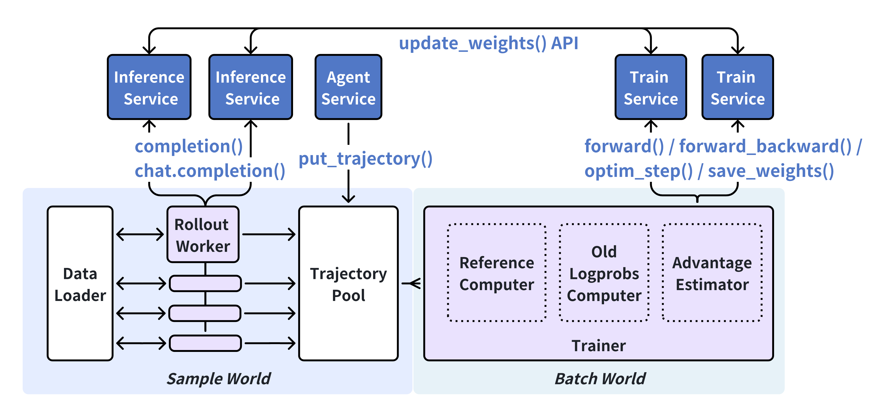

English | [简体中文](../../../zh/developer-guide/02-core-architecture/overview.md) | [Documentation index](../../index.md)

# Core Architecture Overview

> **Schema note:** Configuration snippets on this architecture page describe historical interfaces. Use [`recipe/math/weaver.yaml`](../../../../recipe/math/weaver.yaml) for the current runnable schema.

NorthRL coordinates reinforcement learning from a local CPU driver, using remote services for model execution. This document provides an overview of the system architecture and core components.

## Key Features

- **Local Driver**: Runs task coordination locally and uses Weaver for remote training and sampling
- **Modular Design**: Clean separation of concerns with well-defined interfaces and extensible components
- **Training-as-a-Service & Rollout-as-a-Service**: Unified API architecture that seamlessly supports different training and inference frameworks through service abstraction
- **Concurrency Control**: Configurable rollout concurrency to fit driver memory and remote service capacity
- **Activity Tracking**: Monitoring and error reporting during training
- **Error Handling**: Centralized error reporting and recovery mechanisms

## Architecture Diagram



## Core Components

### 1. NorthRLController

**Purpose**: Main orchestrator that initializes and coordinates all components

**Responsibilities**:
- Initialize all local framework modules
- Manage module lifecycle (start and stop)
- Coordinate validation cycles and checkpointing
- Monitor reported errors and handle failures
- Manage weight synchronization timing

**Key Methods**:
- `__init__(config)`: Initialize all modules
- `run()`: Start training loop and monitoring
- `stop()`: Gracefully shutdown all components
- `_check_finish()`: Determine if training should terminate

See [Controller Details](controller.md) for in-depth documentation.

### 2. DataLoader

**Purpose**: Provides input data for rollout workers (training and validation)

**Responsibilities**:
- Load and manage training/validation datasets
- Shuffle and batch data appropriately
- Track data consumption and completion
- Control when workers can claim the next input batch

**Implementations**:
- `MockDataLoader`: For testing and development
- `TorchDataLoader`: PyTorch-based data loading from files
- `BaseDataLoader`: Abstract interface for custom loaders

See [Data Loader Guide](../03-data-loader/data-loader.md) for detailed documentation.

### 3. RolloutWorkers

**Purpose**: Execute environment interactions and generate trajectories

**Responsibilities**:
- Retrieve tasks from dataloader
- Execute agent/LLM interactions
- Evaluate results and compute rewards
- Generate training trajectories
- Submit trajectories to trajectory pool
- Support validation mode switching

**Implementations**:
- `SimpleRolloutWorker`: Basic LLM completion
- `SingleTurnRolloutWorker`: Single-response generation and reward evaluation
- `E2BRolloutWorker`: Remote agent execution and evaluation in an E2B sandbox
- Custom workers: Task-specific implementations

See [Rollout Workers Guide](../05-rollout-workers/overview.md) for detailed documentation.

### 4. TrajectoryPool

**Purpose**: Collects and batches trajectories from rollout workers

**Responsibilities**:
- Receive one complete `Trajectory` per rollout
- Keep separate model stores; group by the configured identity key (`group_id` for GRPO)
- In grouped mode, deliver complete groups only after all expected rollout slots arrive
- Coordinate with weight synchronization
- Manage multiple model stores

**Features**:
- Simple storage or complete-group storage; one configured grouping key at most
- Complete-group delivery and whole-round SFT delivery
- Weight sync coordination

See [Trajectory Pool Guide](../04-trajectory-pool/trajectory-pool.md) for detailed documentation.

### 5. Trainer

**Purpose**: Processes trajectories and executes training (with integrated algorithm logic)

**Responsibilities**:
- Fetch complete trajectories with `TrajectoryPool.get_trajectories(model_tag)`
- Keep complete trajectories through `_prepare_trajectories()`; convert their sequences to Datums internally
- Execute training steps via training service
- Manage checkpoints
- Compute and log metrics
- Notify weight sync on updates

**Implementations**:
- `RemoteApiGrpoTrainer`: GRPO for Tinker/Weaver
- `RemoteApiCrossEntropyTrainer`: Supervised learning for Tinker/Weaver
- Custom trainers: New RL algorithms


### 6. WeightSyncController

**Purpose**: Manages model weights and synchronization coordination

**Responsibilities**:
- Coordinate weight updates between training and inference
- Manage synchronization modes (sync, fully-async, batch-async)
- Track model versions and staleness
- Trigger validation cycles
- Block workers during sync when needed

**Synchronization Modes**:
- **sync**: All workers wait for newest version
- **fully-async**: No blocking, opportunistic updates
- **batch-async**: Block when staleness exceeds threshold

See [Weight Synchronization Guide](../08-features/weight-synchronization.md) for detailed documentation.

### 7. Validator

**Purpose**: Collects validation trajectories and computes metrics

**Responsibilities**:
- Receive validation trajectories from workers
- Track validation completion
- Compute metrics (mean reward, accuracy, etc.)
- Log validation results
- Notify controller when complete

**Features**:
- Simple collection without complex batching
- Automatic metric aggregation
- Integration with weight sync cycles

See [Validation Guide](../08-features/validation.md) for detailed documentation.

### 8. ActivityTracker

**Purpose**: Monitors system activity, coordinates error reporting and experiment logging

**Responsibilities**:
- Track in-flight work across all modules
- Centralized error reporting
- Coordinate experiment logging (W&B, etc.)
- Provide quiescence detection

**Key Features**:
- Context manager API for easy tracking
- Automatic error reporting
- Rollout worker-specific monitoring
- Training step tracking

See [Activity Tracking Guide](activity-tracking.md) for detailed documentation.

## Data Flow

### Training Pipeline

The grouped RL path uses these interfaces:

```text
DataLoader.get_next_item()
    ↓ one execution request
RolloutWorker.execute_rollout(task)
    └─ rollout(task) → _put_trajectory(complete_trajectory)
    ↓ publish after rollout returns
TrajectoryPool.put_trajectory(complete_trajectory)
    ↓ get_trajectories(model_tag): complete groups or None while waiting
RemoteApiTrainer.train(list[Trajectory])
    ├─ _prepare_trajectories(...) → complete list[Trajectory]
    ├─ convert corresponding sequences → Datums
    └─ forward_backward / optim_step
    ↓ exported sampling weights
WeightSyncController.train_worker_notify_weight_update(...)
```

### Validation Pipeline

```
┌──────────────────┐
│ ValidateDataLoader│
└──────┬────────────┘
       │ (validation mode)
       ▼
┌─────────────────┐
│ RolloutWorker   │
│  (validate mode)│
└──────┬──────────┘
       │ put_trajectory()
       ▼
┌──────────────┐
│ Validator    │
│  - collect   │
│  - compute   │
└──────┬───────┘
       │ metrics
       ▼
┌──────────────────────┐
│ WeightSyncController │
│  (unlock)            │
└──────────────────────┘
```

## Module Interaction Patterns

### Initialization Pattern

1. **Controller** creates all modules
2. **Controller** sets up module references
   - RolloutWorkers ← DataLoader, TrajectoryPool, WeightSync
   - TrajectoryPool ← DataLoader, WeightSync
   - Trainer ← TrajectoryPool, WeightSync
3. **Controller** sets up ActivityTracker for all
4. **Controller** starts all modules

### Activity Tracking Pattern

```python
# In any module
with self._activity_tracker.track("ModuleName", "work_description"):
    # Perform work
    result = do_work()
    # Automatic error reporting and activity tracking
```

### Weight Synchronization Pattern

1. **Trainer** completes training step
2. **Trainer** notifies WeightSync
3. **WeightSync** blocks new trajectories
4. **WeightSync** syncs weights to inference service
5. **WeightSync** triggers validation (if configured)
6. **WeightSync** unblocks trajectories

### Error Handling Pattern

1. **Module** encounters error
2. **Module** reports via ActivityTracker
3. **ActivityTracker** logs error with context
4. **Controller** checks reported errors periodically
5. **Controller** decides action based on policy

## Configuration Structure

NorthRL uses Hydra for configuration management. Key sections:


<a id="launch-modes"></a>
<a id="local-mode"></a>

## Local Execution

The controller, data loader, trajectory pool, and rollout workers run in the local driver process. Weaver performs model training and sampling remotely, and E2B tasks use their configured sandbox service. Rollout concurrency is controlled by `rollout.num_workers`; size it to the local driver and service capacity.

Start through `python -m northrl.main`, which validates the recipe, creates the controller, and manages retries and cleanup. See [Run Locally](../01-getting-started/quick-start.md#run-locally) for the complete command and required environment.

## Extension Points

NorthRL is designed for extensibility. Key extension points:

### 1. Custom Rollout Workers

Extend `BaseRolloutWorker` and implement `async rollout(task)`. Submit one
complete `Trajectory` through `_put_trajectory()` and return its result. For
remote agent tasks, use `E2BRolloutWorker` with task-defined `run_agent` and
`evaluate` hooks; see [Custom Workers](../05-rollout-workers/custom-workers.md).

### 2. Custom Trainers


### 3. Custom Data Loaders

Extend `BaseDataLoader`:

```python
class MyDataLoader(BaseDataLoader):
    def get_next_item(self):
        # Custom data loading
        pass
```

### 4. Custom Evaluators

For single-turn tasks, provide a reward callable that accepts `(task, result)`
and register its name in `northrl.rewards.REWARD_FNS`. Remote E2B tasks provide an
async `evaluate(input_data, workspace, agent_result, evaluation_assets)` hook
returning `EvaluationResult`. See [Evaluators](../05-rollout-workers/evaluators.md).

## Best Practices

### Module Development

1. **Always inherit from NorthRLModule** for consistent module interfaces
2. **Implement proper cleanup** in stop() methods
3. **Use activity tracking** for long-running operations
4. **Report exceptions** through activity tracker

### Resource Management

1. **Set `rollout.num_workers`** to fit local CPU and memory capacity
2. **Limit concurrent requests** with `rollout.max_concurrent_requests` when needed to respect remote service capacity
3. **Monitor driver memory and rollout progress** through the activity tracker
4. **Configure model training and sampling** through the remote service settings

### Error Handling

1. **Use structured error reporting** through ErrorReporter
2. **Implement proper retry logic** for transient failures
3. **Review reported errors** through activity tracker
4. **Define clear error policies** for different scenarios

### Configuration Management

1. **Use Hydra** for configuration management
2. **Define environment-specific overrides**
3. **Validate configurations** before running
4. **Document configuration options** clearly

## Next Steps

- Explore [Controller Details](controller.md) for orchestration logic
- Learn about [Data Types](data-types.md) used throughout the system
- Understand [Activity Tracking](activity-tracking.md) for monitoring
- Review individual component guides for detailed implementation
