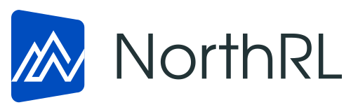

<p align="center">
  <picture>
    <source media="(prefers-color-scheme: dark)" srcset="../imgs/northrl-logo-dark.svg">
    
  </picture>
</p>

<p align="center"><strong>通过 API 开展 Agentic RL，无需管理 GPU 基础设施。</strong></p>

<p align="center">
  <a href="#why-northrl">核心优势</a>&nbsp;·
  <a href="#agentic-rl">训练你的 Agent</a>&nbsp;·
  <a href="#partial-rollout">Partial rollout</a>&nbsp;·
  <a href="#examples">训练示例</a>&nbsp;·
  <a href="#getting-started">快速开始</a>&nbsp;·
  <a href="index.md">文档</a>&nbsp;·
  <a href="../en/README.md">English</a>
</p>

---

NorthRL 帮助你用强化学习提升 Agent 的任务能力。沿用已有的工具、工作流和评测方式，针对你的任务训练模型，让 Agent 更好地完成实际工作。

**在本地运行 NorthRL，通过 API 训练。** [Weaver](https://weaver.nex-agi.cn/) 提供模型训练与采样服务，[NorthGate](https://northgate.xiaobei.top/) 将 Agent 的模型调用接入这些服务，并返回训练所需的 token 数据。你可以专注于开发任务和运行实验，无需自行搭建 GPU 集群。

<a id="key-features"></a>
<a id="why-northrl"></a>

## 核心优势

- **通过 API 训练与采样。** 在本地运行实验，由远程服务提供模型训练与采样能力。开发任务、工具和评测，无需自行搭建 GPU 集群。
- **接入已有 Agent。** 沿用现有的工具和执行逻辑，接入任务执行与评分接口。NorthRL 自动记录模型交互，根据任务奖励更新模型。
- **Rollout 与训练异步执行。** 通过 [partial rollout](#partial-rollout)，已完成的 rollout 组可以进入训练，耗时较长的任务跨训练步继续执行，待所在组完成后参与后续训练批次。

<a id="agentic-rl"></a>

## 训练你的 Agent

**1. 准备任务和评分规则**

明确 Agent 的任务目标及评测方式。例如，代码修复任务提供问题描述和代码仓库，再根据测试通过情况评分。评分结果作为训练的奖励信号。

**2. 接入已有 Agent**

通过 `run_agent` 运行 Agent，通过 `evaluate` 评估最终回答或任务产物并返回评分。沿用已有的工具和执行逻辑，在 [E2B](https://e2b.dev/) 模板中配置所需依赖。NorthRL 负责沙箱内的任务执行与评测。

**3. 连接模型服务**

[Weaver](https://weaver.nex-agi.cn/) 提供模型训练与采样，[NorthGate](https://northgate.xiaobei.top/) 连接 Agent 的模型调用。选择可训练的模型，让 Agent 使用 NorthRL 提供的 OpenAI 或 Anthropic 兼容接口；训练轨迹会自动记录。

**4. 在本地启动训练**

配置服务凭据，在训练配方中指定任务数据、任务接口、E2B 模板和模型，然后从本地启动。NorthRL 执行 **任务执行 → 评测与评分 → 模型更新** 的循环，通过任务得分和执行记录跟踪训练进展。

参考[任务示例](../../recipe/e2b_minimal/rollout.py)编写接口，按照[接入指南](developer-guide/05-rollout-workers/e2b-task-integration.md)完成训练配置。

<a id="partial-rollout"></a>

## Partial rollout

**减少长尾任务引起的训练等待。** 当训练需要等待一批 rollout 全部完成时，少数耗时较长的任务会延迟模型更新。NorthRL 使用已完成的 rollout 组构建训练批次；未完成的任务跨训练步继续执行，待所在组完成后参与后续训练。

**权重切换，Agent 无感。** 训练服务 Weaver 负责切换模型权重，配合 NorthRL 的 partial rollout，让长任务跨越模型更新继续执行。Agent 沿用原有的任务逻辑，无需处理权重切换，也无需重启或重建工作环境。

[](../imgs/northrl-weaver-northgate.svg)

*动画展示支持 `retract` 的 Weaver 全参数微调后端上的运行过程。Agent 进程和工作区持续存在；`retract` 不保证保留已生成的 token 或 KV 状态。点击图片可放大查看。*

<details>
<summary><strong>配置与后端要求</strong></summary>

Partial rollout 使用 `fully-async` 模式。训练批次由完整且可训练的 rollout 组构成，每组包含同一条 prompt 的 `rollout_repeat_n` 个结果。未完成的 token 前缀不会提交训练。

将以下字段合并到已有的 **GRPO 或 OPD 配方**，例如[单轮任务全参数微调配方](../../recipe/math/weaver_full_ft.yaml)。[快速开始](#getting-started)中的 SFT 示例不使用 partial rollout。

```yaml
models:
  actor:
    lora: null
backend:
  type: weaver
training:
  weight_sync:
    mode: fully-async
    freeze_inflight: true
    pause_mode: in_place
```

- **`in_place`**：原地暂停和恢复请求，保留 KV 状态。Weaver 后端必须支持在此状态下替换权重；不支持时不会自动回退。
- **`retract`**：撤回运行中的请求，引擎恢复时重新调度；不保证保留已生成的 token 或 KV 状态。
- **`null` / 不设置**：不暂停引擎。异步 rollout 和训练仍可重叠执行。

引擎暂停要求同时满足 **Weaver、全参数微调（关闭 LoRA）、`fully-async` 和 `freeze_inflight: true`**。`freeze_inflight` 在同步期间阻止新的本地推理调用进入，但它本身不会暂停已经在执行的生成。E2B Agent 使用 rollout 开始时选定的 NorthGate 路由，不会在每轮交互时选择新的 sampler。

完整生命周期见[权重同步与引擎暂停](developer-guide/08-features/weight-synchronization.md#optional-engine-pause)。

</details>

<a id="recipes"></a>
<a id="examples"></a>

## 训练示例

- **[Agent 任务训练](recipe/e2b_minimal/README.md)** — 从任务代码、数据和配置开始，在本地运行一次完整训练。
- **[单轮任务训练](recipe/math/README.md)** — 根据一次回答的结果评分，训练模型完成任务。
- **[SFT](recipe/sft_quickstart/README.md)** — 使用示例数据或自定义对话数据微调模型。
- **[同策略蒸馏](../../recipe/on_policy_distill/weaver_opd.yaml)** — 使用教师模型的 token 对数概率训练学生模型。

[浏览全部示例 →](../../recipe/)

<a id="getting-started"></a>
<a id="quick-start"></a>

## 快速开始

先运行仓库自带的 **SFT 示例**，检查训练环境：8 条对话、1 个 epoch、2 次优化器更新。使用任务奖励训练 Agent 的接入步骤见[训练你的 Agent](#agentic-rl)。

<a id="prerequisites"></a>

**环境要求：** Python 3.12、Weaver 服务地址和 API key，以及所选模型的微调权限。本机需要能够安装依赖、加载模型 tokenizer，无需本地 GPU。

### 1. 安装

在已激活的 Python 3.12 环境中运行：

```bash
git clone https://github.com/beipo-ai/NorthRL.git
cd NorthRL
python -m pip install -e ".[core]"
```

<details>
<summary>环境准备与 CPU 版安装</summary>

如果还没有 Python 环境，在仓库根目录执行以下命令，再安装 NorthRL：

```bash
python3.12 -m venv .venv
source .venv/bin/activate
python -m pip install --upgrade pip
```

在 Linux 上，可以在安装 NorthRL **之前**先安装 CPU 版 PyTorch，避免下载 CUDA 依赖：

```bash
python -m pip install torch==2.7.1 --index-url https://download.pytorch.org/whl/cpu
```

然后执行 `python -m pip install -e ".[core]"`。后续步骤保持该环境处于激活状态。

</details>

### 2. 配置

复制示例配置：

```bash
cp recipe/sft_quickstart/.env.example .env
```

然后在 `.env` 中填写 Weaver 服务地址和 API key：

```dotenv
WEAVER_BASE_URL=https://your-weaver-host
WEAVER_API_KEY=your-weaver-api-key
```

示例使用 `Qwen/Qwen3.5-0.8B:262144`。若要使用服务上的其他模型，请在 `.env` 中设置 `SFT_MODEL` 和匹配的 `SFT_TOKENIZER`。

### 3. 训练

```bash
bash recipe/sft_quickstart/run.sh --check
bash recipe/sft_quickstart/run.sh
```

`--check` 检查本地数据和 tokenizer，过程中可能下载 tokenizer。第二条命令在 Weaver 上启动训练，并检查模型访问权限。

脚本会输出新的 `logs/sft-...` 目录。`northrl.log` 出现 `NorthRL training completed`，且 `exit_code` 为 `0`，表示正常完成。最终检查点的服务端路径记录于该目录下的 `ckpt/weaver_checkpoints.jsonl`。

<details>
<summary><strong>自定义训练配置</strong></summary>

- 将 `SFT_DATA_PATH` 改为自己的 JSONL 对话数据。自带数据用于检查流程；训练和评估模型效果时，请使用有代表性的数据集。
- 默认配方使用全参数微调和 `Qwen/Qwen3.5-0.8B` tokenizer。
- 脚本优先使用仓库中的 `.venv/bin/python`，否则使用当前环境中的 `python`。
- 日志保存在本地，模型权重保存在 Weaver。默认使用 console 日志，W&B 配置可选。

数据格式、模型配置、检查点和训练曲线详见 [SFT 指南](recipe/sft_quickstart/README.md)。

</details>

<a id="architecture"></a>
<a id="documentation"></a>

## 文档

[用户指南](user-guide.md) · [架构](developer-guide/02-core-architecture/overview.md) · [任务接入](developer-guide/05-rollout-workers/e2b-task-integration.md) · [训练指标](metrics.md) · [Rollout 调试](debug_rollout.md) · [开发者指南](developer-guide/README.md)

---

<a id="license"></a>

[Apache 2.0](../../LICENSE) 许可证。
