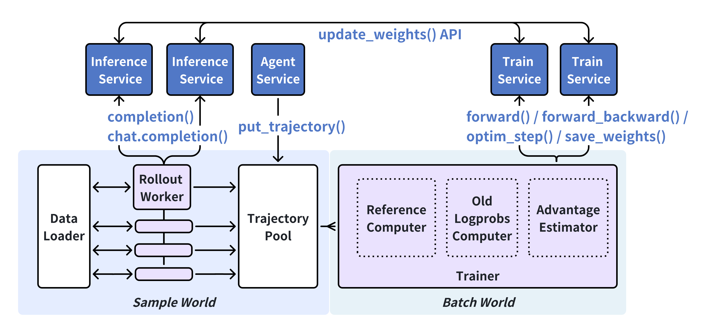

[English](../../../en/developer-guide/02-core-architecture/overview.md) | 简体中文 | [文档目录](../../index.md)

<a id="core-architecture-overview"></a>

# 核心架构概览

> **Schema 说明：** 本架构页面的配置片段描述的是历史接口。当前可运行 schema 请使用 [`recipe/math/weaver.yaml`](../../../../recipe/math/weaver.yaml)。

NorthRL 通过本地 CPU 驱动协调强化学习，模型计算由远端服务执行。本文档概述系统架构和核心组件。

<a id="key-features"></a>

## 主要特性

- **本地驱动**：在本地协调任务，通过 Weaver 完成远端训练与采样
- **模块化设计**：职责划分清晰，接口明确，组件可扩展
- **训练即服务与 Rollout 即服务**：通过服务抽象，统一 API 架构可无缝支持不同的训练和推理框架
- **并发控制**：按驱动内存与远端服务容量配置 rollout 并发
- **活动跟踪**：训练过程中的监控与错误报告
- **错误处理**：集中式错误报告和恢复机制

<a id="architecture-diagram"></a>

## 架构图



<a id="core-components"></a>

## 核心组件

<a id="1-northrlcontroller"></a>

### 1. NorthRLController

**用途**：初始化并协调所有组件的主协调器

**职责**：
- 初始化所有本地框架模块
- 管理模块生命周期（启动与停止）
- 协调验证周期和检查点保存
- 监控上报的错误并处理故障
- 管理权重同步时机

**关键方法**：
- `__init__(config)`：初始化所有模块
- `run()`：启动训练循环和监控
- `stop()`：优雅地关闭所有组件
- `_check_finish()`：判断是否应终止训练

深入说明请参见[控制器详解](controller.md)。

<a id="2-dataloader"></a>

### 2. DataLoader

**用途**：为 rollout 工作进程提供输入数据（训练和验证）

**职责**：
- 加载和管理训练数据集与验证数据集
- 适当打乱数据并分批
- 跟踪数据消费和完成状态
- 控制工作进程何时可以领取下一批输入

**实现**：
- `MockDataLoader`：用于测试和开发
- `TorchDataLoader`：基于 PyTorch 从文件加载数据
- `BaseDataLoader`：自定义加载器的抽象接口

详细说明请参见[数据加载器指南](../03-data-loader/data-loader.md)。

<a id="3-rolloutworkers"></a>

### 3. RolloutWorkers

**用途**：执行环境交互并生成轨迹

**职责**：
- 从数据加载器获取任务
- 执行智能体或 LLM 交互
- 评估结果并计算奖励
- 生成训练轨迹
- 将轨迹提交到轨迹池
- 支持切换验证模式

**实现**：
- `SimpleRolloutWorker`：基本 LLM 补全
- `SingleTurnRolloutWorker`：单响应生成和奖励评估
- `E2BRolloutWorker`：在 E2B 沙箱中执行远程智能体与评估
- 自定义工作进程：任务专属实现

详细说明请参见 [Rollout 工作进程指南](../05-rollout-workers/overview.md)。

<a id="4-trajectorypool"></a>

### 4. TrajectoryPool

**用途**：收集 rollout 工作进程生成的轨迹，并进行批处理

**职责**：
- 每次 rollout 接收一个完整 `Trajectory`
- 按模型分开存储，使用配置的身份键分组（GRPO 使用 `group_id`）
- 分组模式等待预期 rollout 槽位全部到齐后，交付完整组
- 与权重同步协调
- 管理多个模型存储区

**特性**：
- 简单存储或完整组存储；最多配置一个分组键
- 完整组交付与 SFT 整轮交付
- 权重同步协调

详细说明请参见[轨迹池指南](../04-trajectory-pool/trajectory-pool.md)。

<a id="5-trainer"></a>

### 5. Trainer

**用途**：处理轨迹并执行训练（集成算法逻辑）

**职责**：
- 通过 `TrajectoryPool.get_trajectories(model_tag)` 获取完整轨迹
- `_prepare_trajectories()` 保留完整轨迹对象，在内部把对应序列转换为 Datum
- 通过训练服务执行训练步骤
- 管理检查点
- 计算并记录指标
- 更新后通知权重同步

**实现**：
- `RemoteApiGrpoTrainer`：用于 Tinker/Weaver 的 GRPO
- `RemoteApiCrossEntropyTrainer`：用于 Tinker/Weaver 的监督学习
- 自定义训练器：新的强化学习算法


<a id="6-weightsynccontroller"></a>

### 6. WeightSyncController

**用途**：管理模型权重并协调同步

**职责**：
- 协调训练与推理之间的权重更新
- 管理同步模式（sync、fully-async、batch-async）
- 跟踪模型版本和陈旧程度
- 触发验证周期
- 在需要时于同步期间阻塞工作进程

**同步模式**：
- **sync**：所有工作进程等待最新版本
- **fully-async**：不阻塞，择机更新
- **batch-async**：陈旧程度超过阈值时阻塞

详细说明请参见[权重同步指南](../08-features/weight-synchronization.md)。

<a id="7-validator"></a>

### 7. Validator

**用途**：收集验证轨迹并计算指标

**职责**：
- 接收工作进程提交的验证轨迹
- 跟踪验证完成状态
- 计算指标（平均奖励、准确率等）
- 记录验证结果
- 完成时通知控制器

**特性**：
- 简单收集，无需复杂批处理
- 自动聚合指标
- 与权重同步周期集成

详细说明请参见[验证指南](../08-features/validation.md)。

<a id="8-activitytracker"></a>

### 8. ActivityTracker

**用途**：监控系统活动，协调错误报告和实验日志记录

**职责**：
- 跟踪所有模块中正在进行的工作
- 集中式错误报告
- 协调实验日志记录（W&B 等）
- 提供静止状态检测

**主要特性**：
- 提供上下文管理器 API，便于跟踪
- 自动错误报告
- 针对 rollout 工作进程的专门监控
- 训练步数跟踪

详细说明请参见[活动跟踪指南](activity-tracking.md)。

<a id="data-flow"></a>

## 数据流

<a id="training-pipeline"></a>

### 训练流水线

分组 RL 路径使用以下接口：

```text
DataLoader.get_next_item()
    ↓ one execution request
RolloutWorker.execute_rollout(task)
    └─ rollout(task) → _put_trajectory(complete_trajectory)
    ↓ publish after rollout returns
TrajectoryPool.put_trajectory(complete_trajectory)
    ↓ get_trajectories(model_tag): complete groups or None while waiting
RemoteApiTrainer.train(list[Trajectory])
    ├─ _prepare_trajectories(...) → complete list[Trajectory]
    ├─ convert corresponding sequences → Datums
    └─ forward_backward / optim_step
    ↓ exported sampling weights
WeightSyncController.train_worker_notify_weight_update(...)
```

<a id="validation-pipeline"></a>

### 验证流水线

```
┌──────────────────┐
│ ValidateDataLoader│
└──────┬────────────┘
       │ (validation mode)
       ▼
┌─────────────────┐
│ RolloutWorker   │
│  (validate mode)│
└──────┬──────────┘
       │ put_trajectory()
       ▼
┌──────────────┐
│ Validator    │
│  - collect   │
│  - compute   │
└──────┬───────┘
       │ metrics
       ▼
┌──────────────────────┐
│ WeightSyncController │
│  (unlock)            │
└──────────────────────┘
```

<a id="module-interaction-patterns"></a>

## 模块交互模式

<a id="initialization-pattern"></a>

### 初始化模式

1. **控制器**创建所有模块
2. **控制器**设置模块引用
   - RolloutWorkers ← DataLoader、TrajectoryPool、WeightSync
   - TrajectoryPool ← DataLoader、WeightSync
   - Trainer ← TrajectoryPool、WeightSync
3. **控制器**为所有模块设置 ActivityTracker
4. **控制器**启动所有模块

<a id="activity-tracking-pattern"></a>

### 活动跟踪模式

```python
# In any module
with self._activity_tracker.track("ModuleName", "work_description"):
    # Perform work
    result = do_work()
    # Automatic error reporting and activity tracking
```

<a id="weight-synchronization-pattern"></a>

### 权重同步模式

1. **训练器**完成训练步骤
2. **训练器**通知 WeightSync
3. **WeightSync** 阻止新轨迹进入
4. **WeightSync** 将权重同步至推理服务
5. **WeightSync** 触发验证（如果已配置）
6. **WeightSync** 解除对轨迹的阻塞

<a id="error-handling-pattern"></a>

### 错误处理模式

1. **模块**遇到错误
2. **模块**通过 ActivityTracker 报告
3. **ActivityTracker** 记录带上下文的错误
4. **控制器**定期检查上报的错误
5. **控制器**根据策略决定操作

<a id="configuration-structure"></a>

## 配置结构

NorthRL 使用 Hydra 管理配置。主要配置部分如下：


<a id="launch-modes"></a>
<a id="local-mode"></a>

## 本地执行

控制器、数据加载器、轨迹池和 rollout worker 运行在本地驱动进程中。Weaver 在远端执行模型训练与采样，E2B 任务使用配置好的沙箱服务。`rollout.num_workers` 控制 rollout 并发数，应根据本地驱动和服务容量设置。

通过 `python -m northrl.main` 启动，由入口校验配方、创建控制器并管理重试和清理。完整命令与环境要求见[本地运行](../01-getting-started/quick-start.md#run-locally)。

<a id="extension-points"></a>

## 扩展点

NorthRL 为可扩展性而设计。主要扩展点如下：

<a id="1-custom-rollout-workers"></a>

### 1. 自定义 Rollout 工作进程

继承 `BaseRolloutWorker`，实现 `async rollout(task)`，通过 `_put_trajectory()`
提交一条完整 `Trajectory` 并返回结果。远程智能体任务可使用 `E2BRolloutWorker`，
由任务定义 `run_agent` 和 `evaluate` 钩子；详见[自定义 Worker](../05-rollout-workers/custom-workers.md)。

<a id="2-custom-trainers"></a>

### 2. 自定义训练器


<a id="3-custom-data-loaders"></a>

### 3. 自定义数据加载器

继承 `BaseDataLoader`：

```python
class MyDataLoader(BaseDataLoader):
    def get_next_item(self):
        # Custom data loading
        pass
```

<a id="4-custom-evaluators"></a>

### 4. 自定义评估器

单轮任务提供接收 `(task, result)` 的奖励函数，并将名称注册到
`northrl.rewards.REWARD_FNS`。远程 E2B 任务提供异步
`evaluate(input_data, workspace, agent_result, evaluation_assets)` 钩子，
返回 `EvaluationResult`。详见[评估器](../05-rollout-workers/evaluators.md)。

<a id="best-practices"></a>

## 最佳实践

<a id="module-development"></a>

### 模块开发

1. **始终继承 NorthRLModule**，保持模块接口一致
2. 在 stop() 方法中**实现适当的清理逻辑**
3. 对长时间运行的操作**使用活动跟踪**
4. 通过活动跟踪器**报告异常**

<a id="resource-management"></a>

### 资源管理

1. 按本地 CPU 与内存容量**设置 `rollout.num_workers`**
2. 按需通过 `rollout.max_concurrent_requests` **限制并发请求数**，使其符合远端服务容量
3. 通过活动跟踪器**监控驱动内存与 rollout 进度**
4. 通过远端服务配置**设置模型训练与采样**

<a id="error-handling"></a>

### 错误处理

1. 通过 ErrorReporter **使用结构化错误报告**
2. 对暂时性故障**实现适当的重试逻辑**
3. 通过活动跟踪器**检查上报的错误**
4. 针对不同场景**定义清晰的错误策略**

<a id="configuration-management"></a>

### 配置管理

1. **使用 Hydra** 管理配置
2. **定义环境专属的覆盖配置**
3. 运行前**验证配置**
4. 清晰地**记录配置选项**

<a id="next-steps"></a>

## 后续步骤

- 探索[控制器详解](controller.md)，了解协调逻辑
- 了解整个系统使用的[数据类型](data-types.md)
- 阅读[活动跟踪](activity-tracking.md)，了解监控方法
- 查阅各组件指南，了解详细实现
